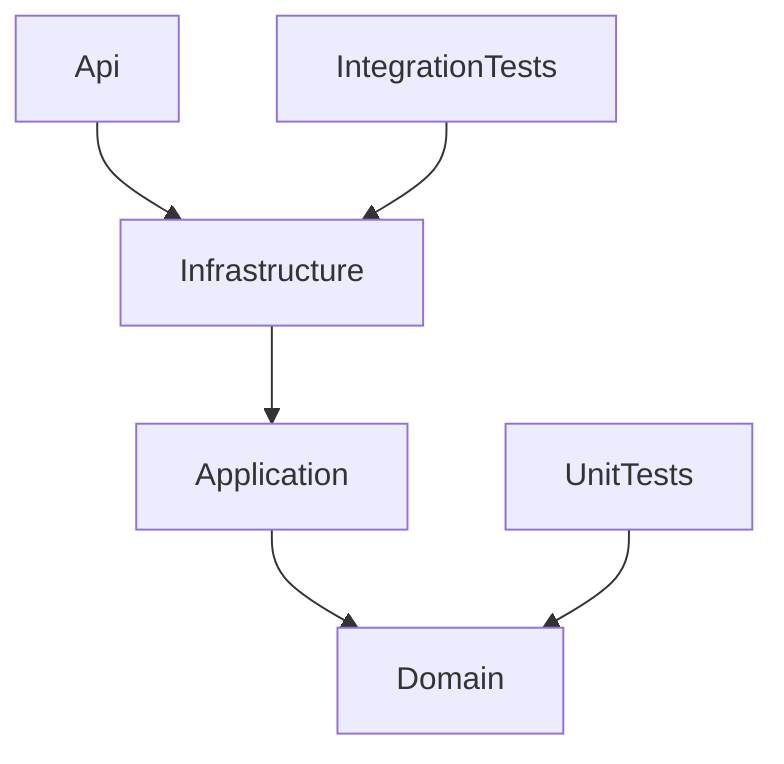

# Dependency map

Arrows mean compile-time project references, not runtime data flow.

The SDK also exposes transitive project references. Api intentionally composes
Infrastructure and calls Application; Infrastructure implements Application ports
and uses Domain entities. Domain never references another solution project.
There are exactly five explicit project-reference edges and no cycles.

Runtime event flow: DistributionService / InteractionService ->
IMarketingEventTransport -> InMemoryMarketingEventTransport -> StatisticsService.
StatisticsService only interprets MarketingEvent; it does not read campaign state.
Runtime state flow: CampaignService -> CampaignStateSynchronizer ->
IDistributionState -> InMemoryDistributionState -> DistributionService.

The repository ports make substitution and cross-project references inspectable.
The event port resembles a Kafka producer/consumer boundary while requiring no broker.
These are deliberate teaching relationships; they do not claim production architecture.
